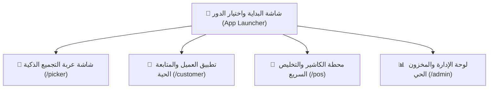

# 🎨 دليل الهوية البصرية، هندسة تجربة المستخدم (UI/UX)، وخطة بناء التطبيق (PWA)
## مشروع عربة التسوق الذكية لمُحضّري الطلبات (Smart Picker Cart)

---

## 1. الهوية البصرية ونظام الألوان (Design System & Color Palette)

تم استخراج وضبط لوحة الألوان بدقة من الهوية المعتمدة، مع تحديد الاستخدام الوظيفي الدقيق لكل لون لضمان أعلى مستويات التباين والراحة البصرية وسرعة اتخاذ القرار:

```
┌────────────────────────────────────────────────────────────────────────┐
│  Ink Black       Dark Slate Grey    Wheat       Burnt Orange  Midnight │
│  #04151F         #183A37            #EFD6AC     #C44900       #432534  │
└────────────────────────────────────────────────────────────────────────┘
```

### التوزيع الوظيفي للألوان (Semantic Color Tokens):

| اللون | كود HEX | النسبة والدور الأساسي في الواجهة |
| :--- | :--- | :--- |
| **Ink Black** | `#04151F` | **الخلفية العميقة والعناصر السيادية:** خلفية التطبيق الأساسية في الوضع الداكن، الشريط العلوي (Header)، وقوائم الملاحة. يعطي فخامة وتركيزاً بصرياً عالياً بدون إجهاد للعين تحت إضاءة السوبر ماركت القوية. |
| **Dark Slate Grey**| `#183A37` | **أسطح البطاقات والحاويات (Card Surfaces):** خلفيات الكروت، الفواصل الناعمة، وحاويات الأقسام. يوفر تبايناً هادئاً يبرز المحتوى دون حدة. |
| **Wheat** | `#EFD6AC` | **اللمسات الدافئة والشارات التوضيحية (Warm Accents):** النصوص الثانوية الهامة، شارات الممرات والأقسام (Badges)، المؤشرات الزمنية، وخلفيات الوسوم المميزة. |
| **Burnt Orange** | `#C44900` | **أزرار الأكشن الرئيسية والمؤشرات الحيوية (Primary CTA):** زر المسح الضوئي (Scan Button)، زر تأكيد الإضافة، عداد التنبيهات الحية، وحالة النشاط المباشر. لون ناري جذاب يلتقطه البصر فوراً في أقل من ثانية. |
| **Midnight Violet**| `#432534` | **الحالات الخاصة والبدائل الذكية (Special States):** بطاقات طلب البدائل، وسوم الأصناف الحساسة أو التنبيهات الخاصة بالعميل. |
| **Surface White** | `#FFFFFF` | نصوص العناوين الرئيسية والأرقام الحيوية لتحقيق تباين WCAG AAA للقراءة السريعة. |
| **Muted Slate** | `#8E9DA8` | النصوص الفرعية والإرشادات المصغرة. |

---

## 2. التايبوجرافي واختيار الخط (Typography System)

لأن التطبيق يُستخدم في بيئة سريعة وشاشات هواتف وتابلت متحركة، يحتاج الخط إلى **هندسة حروفية واضحة جداً، زوايا مقروءة، وأرقام إنجليزية واضحة بدون لبس بين الأصفار والآحاد**:

* **الخط المعتمد للغة العربية:** **Alexandria (Google Font)**
  * *لماذا؟* خط عربي حديث مصمم خصيصاً للواجهات الرقمية والتطبيقات الذكية، يتميز بوزن متوازن، وحروف مفتوحة مريحة للعين، وأناقة هندسية تبتعد تماماً عن الخطوط التقليدية القديمة.
* **خط الأرقام والباركود والأكواد:** **Outfit / Space Grotesk**
  * لضمان ظهور أسعار المنتجات، أرقام الباركود، وأرقام الممرات بأقصى درجات الوضوح والدقة.

```css
/* Typography Scale */
--font-family-ar: 'Alexandria', -apple-system, sans-serif;
--font-family-num: 'Outfit', 'Alexandria', sans-serif;

--text-display: 2rem (32px) / font-bold;      /* أرقام الممرات والإجمالي */
--text-h1:      1.5rem (24px) / font-bold;     /* عناوين الصفحات */
--text-h2:      1.125rem (18px) / font-semibold; /* أسماء المنتجات */
--text-body:    0.9375rem (15px) / font-normal;  /* التفاصيل والأسعار */
--text-caption: 0.8125rem (13px) / font-medium;  /* شارات الأقسام والحالات */
```

---

## 3. نظام الأيقونات المعتمد (Strictly Iconography - No Emojis)

بناءً على التوجيه الصارم: **يُمنع منعاً باتاً استخدام الإيموجيهات التقليدية**.  
سنعتمد نظام أيقونات خطي فاخر **(Lucide Modern SVG Icons)** بسماكة خط موحدة `stroke-width="1.8"` ونهايات دائرية مريحة:

| الوظيفة في التطبيق | الأيقونة المعتمدة (Lucide SVG) | الدلالة البصرية |
| :--- | :--- | :--- |
| **مسح الباركود (Scan)** | `ScanLine` / `Barcode` | تحديد مربع المسح والتقاط الكود فوراً |
| **المسار والممر (Aisle / Route)** | `MapPin` / `Compass` | موقع الصنف في السوبر ماركت (ممر A - رف 3) |
| **تم التجهيز والاعتماد** | `CheckCircle2` | دائرة خضراء معتمدة مع علامة الصح |
| **صنف غير متوفر (Out of Stock)**| `PackageX` / `AlertCircle` | تنبيه سريع لفقدان الصنف |
| **تبديل الصنف ببديل** | `RefreshCw` / `ArrowLeftRight` | حركة التبديل التلقائي مع العميل |
| **العربة وتجميع الأصناف** | `ShoppingCart` / `ShoppingBag`| سلة التسوق وصناديق التجميع |
| **الكاشير والإنهاء السريع** | `QrCode` / `Receipt` | كود التخليص الفوري والفاتورة الرقمية |
| **المؤقت والعد التنازلي** | `Timer` / `Hourglass` | الوقت المتبقي لرد العميل على البديل |
| **الوزن والميزان** | `Scale` | الأصناف ذات الوزن العشوائي (خضار/جبن) |

---

## 4. فلسفة تجربة المستخدم (UX Principles - Zero Clutter)

1. **الزر يتحدث عن نفسه (Self-Explanatory Actions):**
   * لا توجد نصوص شرح طويلة أو فقرات تبرير تحت الأزرار. الزر يحتوي على **أيقونة معبرة + كلمة واحدة أو كلمتين فقط** مثل: `[مسح الباركود]` أو `[طلب بديل]` أو `[تأكيد البديل]`.
2. **شاشات عالية التباين للمُحضّر (High-Contrast Glanceability):**
   * شاشة العربة يُنظر إليها من على بعد 50 سم أثناء دفع العربة، لذا يكون الصنف الحالي كبيراً جداً في المنتصف مع صورة واضحة وموقعه بالممر بخط عريض.
3. **تغذية حسية فورية (Instant Haptic & Audio Feedback):**
   * عند مسح كود صحيح: رنين مريح قصير (Chime Sound) + وميض أخضر خفيف.
   * عند خطأ في الكود: نغمة تنبيه مميزة (Alert Sound) + اهتزاز للموبايل (Haptic Vibration).
4. **شريط حالة العميل الحي (Micro-State Live Bar):**
   * شاشة العميل تحتوي على مؤشر تقدم حي يتحدث فور مسح المحضر لأي علبة، ليعيش العميل تجربة التسوق الواقعية لحظة بلحظة.

---

## 5. معمارية تحويل الموقع لتطبيق هاتف حقيقي (PWA Specification)

لكي يعمل النظام على الهاتف والتابلت كتطبيق حقيقي قابل للتثبيت (Installable Mobile App) بدون متصفح وعناوين URL:

1. **Web App Manifest (`manifest.json`):**
   * `display: "standalone"` لإخفاء شريط المتصفح العلوي والسفلي تماماً والعمل بشاشة كاملة (Full Screen).
   * `theme_color: "#04151F"` لضبط لون شريط الحالة العلوي للموبايل (Status Bar).
   * أيقونات تطبيق عالية الدقة بأحجام مختلفة (192x192 و 512x512).
2. **زر التثبيت المباشر (One-Click Install Banner):**
   * واجهة ذكية تكتشف الجهاز وتعرض زراً أنيقاً: `[تثبيت التطبيق على الشاشة الرئيسية]` للتثبيت بضغطة واحدة.
3. **دعم كامل لكاميرا الموبايل ومستشعراتها:**
   * تشغيل الكاميرا الخلفية تلقائياً بدقة عالية مع دعم تشغيل كشاف الفلاش (Torch) للأرفف المظلمة.

---

## 6. تفصيل الشاشات الأربع للنظام (Screen-by-Screen Blueprint)



### 1️⃣ شاشة عربة التجميع (`/picker`)
* **رأس الشاشة (Header):** رقم العربة (`العربة #04`)، رقم الأوردر، شريط التقدم الدائري (`8 / 12 صنف`).
* **بطاقة الصنف النشط الحالية (Hero Active Item):**
  * صورة واضحة للمنتج.
  * اسم المنتج بحجم كبير (`حليب كامل الدسم 1 لتر`).
  * شارة الممر والرف (`ممر 3B - رف 02`).
  * الكمية المطلوبة بالخط العريض (`الكمية: 2 عبوة`).
* **منطقة الأكشن السريع (Action Strip):**
  * زر عريض باللون الناري (`#C44900`): **[ مسح الباركود ]** يفتح الكاميرا فوراً في نافذة سريعة.
  * زر فرعي بلون Slate: **[ غير متوفر / اقتراح بديل ]**.
* **قائمة الأصناف المتبقية (Queue):** مرتبة تنازلياً حسب أقرب ممر في المسار.
* **نافذة البدائل:** تظهر 3 كروت للبدائل المتاحة، يضغط العامل على إحداها فتذهب فوراً لتطبيق العميل مع مؤقت تنازلي (3:00 دقيقة) دون تعطيل العامل عن إكمال الأصناف التالية.
* **شاشة الإنجاز (Done):** ظهور **Master Clearance QR Code** بحجم كبير للمسح عند الكاشير.

### 2️⃣ تطبيق العميل والمتابعة الحية (`/customer`)
* **وضع التسوق (Catalog & Cart):** تصفح المنتجات بتصنيفات نظيفة وإضافتها للسلة بلمسة واحدة، ثم الضغط على `[ إرسال الطلب للتجهيز ]`.
* **وضع المتابعة الحية (Live Order Tracker):**
  * حالة التجهيز المباشرة في شريط أنيق: (استلام الطلب ⬅️ جاري التجميع 🛒 ⬅️ فحص الجودة ⬅️ جاهز للاستلام/التوصيل).
  * قائمة الأصناف مع حالة كل صنف بأيقونات واضحة:
    * أيقونة انتظار رمادية ⏳
    * أيقونة فحص زرقاء متحركة 🔄
    * أيقونة نجاح خضراء ✅ مع وقت الجمع
  * **شريط إشعار البديل المنبثق (Interactive Substitution Alert):**
    * يظهر عند عدم توفر صنف مع عداد تنازلي وصورة البديل وسعره، وزرين سريعين: `[ قبول البديل ]` أو `[ إلغاء الصنف ]`.

### 3️⃣ محطة الكاشير والتسليم السريع (`/pos`)
* واجهة سريعة لموظف نقطة الاستلام/الكاشير.
* نافذة مسح الـ Master QR الخاص بالعربة عبر الكاميرا أو القارئ الليزري.
* بمجرد المسح: يظهر ملخص الأوردر (الأصناف المجمعة، البدائل المعتمدة، الإجمالي النهائي).
* زر واحد بلون برتقالي: `[ اعتماد وخروج الطلب ]` يطبع إشعار الشحن وينهي الأوردر في ثانيتين فقط.

### 4️⃣ لوحة الإدارة ومراقبة العربات والمخزون (`/admin`)
* مراقبة جميع العربات النشطة وسرعة كل عربة.
* إدارة المنتجات وأسعارها والباركود وقسم كل منتج.

---

## 7. خطة المهام التنفيذية (Actionable Tasks Roadmap)

- [ ] **المهمة 1: إعداد بيئة المشروع وهيكلة الخادم (Server & Dependencies)**
  - تهيئة تطبيق Node.js مع Express و Socket.IO.
  - إعداد قاعدة بيانات محلية سريعة بالمنتجات الوهمية الواقعية (سوبر ماركت حقيقي بأقسامه وباركوداته).
- [ ] **المهمة 2: إعداد دعم التطبيق التثبيتي (PWA Assets & Manifest)**
  - إنشاء ملف `manifest.json` بإعدادات standalone وألوان الهوية (`#04151F`).
  - إعداد Service Worker للعمل السريع بدون اتصال وشاشات التحميل.
- [ ] **المهمة 3: بناء محرك البث اللحظي (Socket.IO Event Engine)**
  - برمجة غرف التواصل اللحظي: حدث مسح صنف، حدث اقتراح بديل، حدث قبول البديل، حدث اكتمال الأوردر.
- [ ] **المهمة 4: بناء واجهة عربة التجميع الذكية (`/picker`)**
  - دمج قارئ الباركود عبر الكاميرا (`html5-qrcode`) مع الصوتيات والاهتزاز.
  - بناء منطق المسار الأمثل (Aisle sequence) وكروت الأصناف بدون حشو كلامي.
  - توليد كود الـ Master QR عند الاكتمال.
- [ ] **المهمة 5: بناء تطبيق العميل والمتابعة الحية (`/customer`)**
  - شاشة اختيار المنتجات وإنشاء الأوردر.
  - شاشة التتبع الحي المباشر والتفاعل الفوري مع البدائل.
- [ ] **المهمة 6: بناء شاشة الكاشير السريع (`/pos`)**
  - مسح الـ Master QR واعتماد الطلب الفوري.
- [ ] **المهمة 7: الاختبار التكاملي والتشغيل المتعدد على الشبكة المحلية**
  - تجربة فتح التطبيق وتثبيته على عدة هواتف ولابتوب متصلين في نفس اللحظة وتوثيق طريقة التشغيل.
