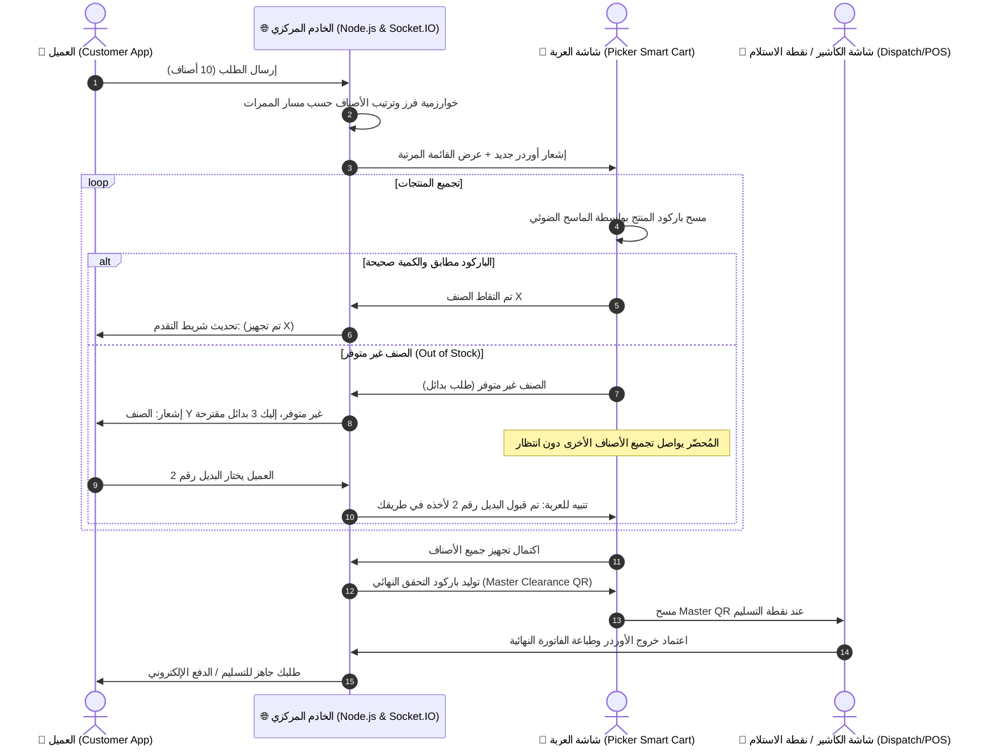

# 🛒 مشروع عربة التسوق الذكية لمُحضّري الطلبات (Smart Picker Cart System)
## وثيقة التصور الشامل، المعمارية الهندسية، والتحسينات التشغيلية
> **النسخة:** 1.0.0  
> **تاريخ التحديث:** أكتوبر 2026  
> **طبيعة المشروع:** نظام إنترنت الأشياء والويب المتكامل لإدارة وتجهيز طلبات السوبر ماركت (Hybrid In-Store Fulfillment)

---

## 1. الملخص التنفيذي والرؤية العامة (Executive Summary & Vision)
في ظل النمو الهائل للتجارة السريعة (Quick Commerce) وطلبات البقالة عبر الإنترنت، تقع السوبر ماركت التقليدية في معضلة كبيرة: **التكلفة العالية والبطء الشديد في تجهيز الأوردرات داخل الفروع العادية (Store-Picking)**.

حالياً، يتحرك مُحضّر الطلبات (Picker) مشتتاً بقوائم ورقية أو عبر محادثات واتساب وتطبيقات تواصل، يبحث في الأرفف عشوائياً، يعاني عند عدم توافر منتج، ويقف مجدداً في طابور الكاشير لإعادة وزن ومسح المنتجات كلها قطعة قطعة!

**رؤية المشروع:**  
تحويل عربة التسوق التقليدية إلى **محطة عمل متنقلة وذكية (Mobile Edge Picking Station)** مزودة بشاشة تفاعلية وماسح باركود، متصلة سحابياً بنظام السوبر ماركت وتطبيق العميل في الوقت الفعلي (Real-Time)، بحيث تضمن:
1. أعلى سرعة تجميع عبر توجيه العربة بأقصر مسار داخل الممرات.
2. دقة 100% ومنع الخطأ البشري بمسح الباركود الفوري لحظة الوضع في العربة.
3. تفاعل فوري مع العميل للبدائل والتعديلات دون تعطيل حركة المُحضّر.
4. إلغاء طابور الكاشير بالكامل عبر "الفاتورة الرقمية المعتمدة" ورمز الفحص السريع (Fast-Pass Master QR).

---

## 2. دراسة المشكلة وفجوات السوق (Problem Statement & Market Gaps)

### المؤشرات التشغيلية المستهدفة:
* **تقليل زمن التجهيز (Pick-to-Bag Time):** بنسبة تصل إلى **60%**.
* **تقليل أخطاء اختيار المنتجات (Picking Error Rate):** إلى أقل من **0.5%** بفضل التدقيق بالباركود.
* **إلغاء وقت انتظار الكاشير:** من 8 دقائق متوسط إلى **أقل من 30 ثانية** (فقط استخراج ملصق الشحنة ومراجعة الباركود المجمع).
* **رفع رضا العميل (Customer Satisfaction):** عبر إشراكه لحظياً في مراحل تجهيز طلبه.

---

## 3. تفاصيل دورة حياة النظام (System Workflow & Architecture)

النظام عبارة عن منظومة ثلاثية الأطراف متصلة عبر شبكة سريعة بزمن استجابة فوري (Real-Time WebSockets):

---

## 4. التحسينات الذكية المقترحة لترقية الفكرة لمستوى عالمي (Smart Upgrades)

لضمان تميز المشروع من الناحية العلمية والتطبيقية، نقترح إضافة التحسينات المحورية التالية:

### 1) نظام التجميع المتعدد المرمز بالألوان (Multi-Order Batch Picking + Put-to-Light)
* **المشكلة:** إذا كانت العربة تجهز أوردر واحد فقط في كل رحلة، سيمشي العامل كثيراً لأوردرات صغيرة (مثل أوردر فيه صنفين فقط).
* **الحل الذكي:** تقسم العربة داخلياً إلى 3 أو 4 صناديق/أقسام بألوان مميزة (أحمر، أزرق، أخضر، أصفر).
  * يقوم النظام بدمج منتجات 3 أوردرات في رحلة واحدة داخل الممر.
  * عند مسح علبة حليب مثلاً، تضيء الشاشة باللون **الأزرق** وتكتب: *"ضع في الصندوق B (أوردر أحمد)"*.
  * النتيجة: تقليل مسافة المشي بنسبة 300%!

### 2) خوارزمية المسار الأمثل داخل الممرات (Dynamic Aisle Routing - TSP Optimization)
* بدلاً من مجرد التجميع حسب القسم، يتم ترتيب المنتجات وفق تسلسل مدروس بدقة:
  1. **المنتجات الثقيلة والجافة أولاً (Dry & Heavy):** الأرز، الزيوت، المعلبات (توضع في أسفل العربة).
  2. **المنتجات العامة والمنظفات ثانياً.**
  3. **المخبوزات والخضار الحساسة ثالثاً (Fragile):** الشيبس، البيض، الخبز (حتى لا تُسحق).
  4. **المثلجات والمبردات أخيراً (Frozen & Chilled):** الآيس كريم واللحوم، لتقليل وقت بقائها خارج الثلاجات.

### 3) بروتوكول البدائل الذكي غير المعطل (Non-Blocking Asynchronous Substitution)
* **المشكلة:** في الطرق التقليدية، يقف العامل حائراً أمام الرف يتصل بالعميل والعميل لا يرد، مما يعطل كل شيء.
* **الحل المقترح:**
  * يضغط العامل على زر *"غير متوفر"*، فيقترح النظام فورياً 3 بدائل (نفس الفئة، سعر مقارب).
  * يُرسل إشعار للعميل مع **عداد تنازلي (مثلاً: 3 دقائق)**.
  * في هذه الأثناء، يكمل العامل مساره ويجمع بقية المنتجات طبيعياً!
  * إذا اختار العميل البديل قبل انتهاء الجولة، يُدرج في أقرب نقطة بالمسار.
  * إذا انتهى الوقت دون رد، يطبق خيار العميل المسبق (إلغاء الصنف تلقائياً أو اختيار البديل الأعلى تقييماً).

### 4) دعم الأصناف الموزونة ذات الباركود المتغير (Random-Weight & Fresh Produce Support)
* في السوبر ماركت، الفواكه والخضار والجبن واللحوم تباع بالكيلو، ويكون الباركود مطبوعاً من ميزان السوبر ماركت (يبدأ عادةً بـ `20` أو `28` ويحتوي الوزن والسعر داخل الباركود نفسه - EAN-13 Variable Weight).
* **الحل:** تزويد شاشة العربة ببرمجة قادرة على فك تشفير هذا الباركود وقراءة الوزن الفعلي، أو إمكانية الإدخال اليدوي/الربط بميزان العربة.

### 5) كود التخليص السريع (Master Clearance Pass - No-Queue Checkout)
* بما أن النظام راقب إدخال كل منتج بالباركود وحسب الإجمالي لحظياً، لا داعي لتفريغ العربة على شريط الكاشير ومسح 40 منتج مرة أخرى!
* الشاشة تصدر **Master QR Code**. يقوم موظف التسليم بمسحه مرة واحدة فقط بجهازه؛ فيظهر له تدقيق سريع، ثم تصدر الفاتورة الإلكترونية مباشرة وخصم الدفع أونلاين.

---

## 5. تحليل التحديات والحلول الهندسية (Challenges & Edge Cases)

| التحدي التشغيلي / الفني | الخطورة المتوقعة | الحل الهندسي المبتكر المعتمد |
| :--- | :--- | :--- |
| **1. ضعف شبكة الواي فاي داخل السوبر ماركت** | انقطاع الشاشة أثناء التجهيز | استخدام تقنية **PWA (Progressive Web App)** مع تخزين محلي (IndexedDB / LocalStorage) بحيث تستمر العربة بالمسح دون توقف، وعند عودة الشبكة تتم المزامنة التلقائية فوراً. |
| **2. تعديل العميل للطلب بعد وصول العامل لآخر الممر** | اضطرار العامل للرجوع مسافات طويلة | تطبيق **قاعدة نطاق الإغلاق (Dynamic Cut-off)**: الأقسام التي تم الانتهاء منها تُغلق للتعديل، أو يُسمح بالتعديل مع إعادة احتساب وقت التسليم المتوقع تلقائياً وتنبيه العميل. |
| **3. خطأ العامل بمسح باركود ووضع منتج آخر** | نقص دقة الأوردر وشكاوى العملاء | واجهة العربة تصدر نغمة صوتية مميزة (Green Chime = صحيح / Red Alarm = منتج خاطئ)، مع إظهار صورة المنتج والمواصفات بشكل بارز، وإمكانية إضافة حساس وزن إلكتروني لاحقاً (Load Cell). |
| **4. تشغيل النظام على عدة أجهزة بدون تكاليف معقدة** | صعوبة تجربة البروتوتايب على عدة أجهزة | بناء واجهة ويب سريعة جداً Responsive تعمل على متصفح أي هاتف/تابلت/شاشة بمجرد فتح الرابط، دون الحاجة لتحميل تطبيقات من المتاجر أثناء مرحلة البروتوتايب. |

---

## 6. الهيكلية التقنية المقترحة للبروتوتايب (Technical Prototype Blueprint)

لتشغيل هذا النموذج بكفاءة عالية على سيرفر محلي أو سحابي والفتح من عدة أجهزة في نفس اللحظة:

### أ) البنية التحتية (Tech Stack):
* **الخادم الخلفي (Backend):**
  * **Node.js** مع إطار عمل **Express.js**.
  * **Socket.IO:** وهو المكون الأهم لتحقيق التزامن الفوري (Zero-Latency Real-Time Sync) بين العميل والعربة والكاشير.
* **قاعدة البيانات (Database):**
  * **SQLite** (باستخدام Better-SQLite3 أو Prisma) - فائقة السرعة، بدون تعقيدات تنصيب، وتعمل كملف واحد محمول يمكن نقله لأي جهاز وسيرفر.
* **الواجهات الأمامية (Frontend):**
  * واجهات ويب حديثة مبنية بنظام **Single Page Application (SPA)** متجاوبة مع كل الشاشات (Mobile / Tablet / Desktop).
  * استخدام **TailwindCSS** لسرعة وأناقة التصميم وسهولة التحكم في الهوية البصرية.
  * مكتبات ماسح الباركود بالكاميرا: **Html5-QRCode** أو **ZXing** (تسمح بفتح كاميرا الموبايل والمسح الفوري للباركود الحقيقي، مع دعم كامل للماسحات الضوئية اليدوية USB/Bluetooth عبر محاكاة لوحة المفاتيح).

### ب) شاشات النظام الرئيسية (User Roles & Interfaces):
1. **شاشة العميل (Customer Web App):**
   * تصفح المنتجات وإضافتها للسلة.
   * إرسال الطلب ومراقبة حالة كل منتج لحظياً (في الانتظار ⏳ - قيد التجهيز 🛒 - تم التجهيز ✅).
   * نافذة التفاعل المباشر للبدائل والتعديلات.
   * الفاتورة الإلكترونية المباشرة.

2. **شاشة عربة التجميع الذكية (Smart Picker Cart Interface):**
   * مصممة خصيصاً لتناسب التابلت أو الهاتف المثبت على مقبض العربة.
   * واجهة سريعة ذات أزرار كبيرة، تدعم الماسح الضوئي (كاميرا أو ليزر).
   * إرشادات الممرات والمسار الأقصر خطوة بخطوة.
   * تنبيهات صوتية وبصرية فورية (صوت النجاح، صوت التحذير).
   * زر طلب البديل السريع، وزر إنهاء الأوردر وتوليد الـ Master QR.

3. **شاشة الإدارة والكاشير (Supermarket Admin / Dispatcher Dashboard):**
   * متابعة حية لجميع العربات النشطة وسرعة كل مُحضّر.
   * إدارة المنتجات والمخزون والأسعار وقسم كل منتج.
   * مسح الـ Master QR لإنهاء الأوردرات وطباعة كشوف الشحن.

---

## 7. خارطة طريق التنفيذ (Actionable Implementation Roadmap)

---

> 💡 **جاهزية المرحلة التالية:**  
> تم حفظ هذه الوثيقة الشاملة كنواة مرجعية للمشروع. بعد مراجعتك وموافقتك على التفاصيل والتحسينات المذكورة، سننتقل فوراً لاختيار الهوية البصرية، وتصميم النظام وقاعدة البيانات، ثم كتابة كود البروتوتايب وتشغيله خطوة بخطوة.
